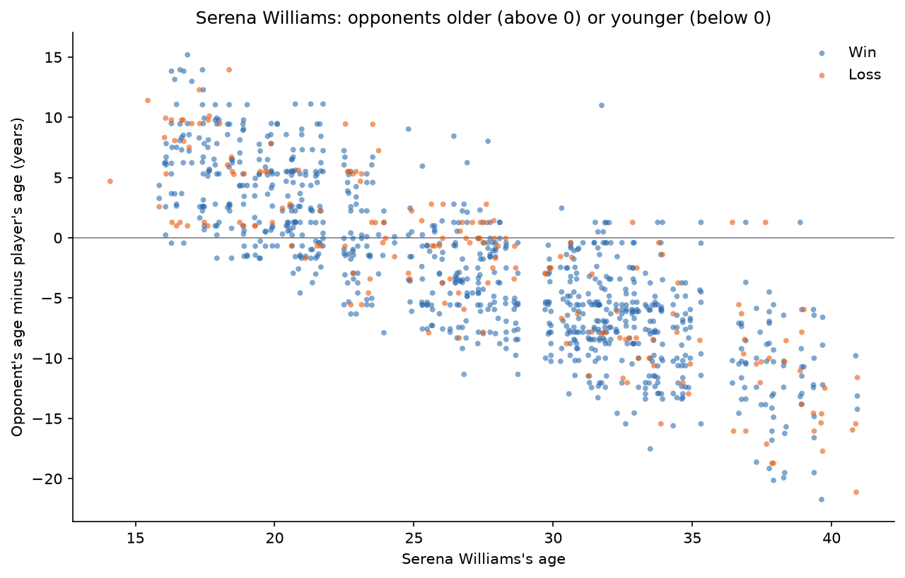

# tenniscareer

A small Python package that downloads a tennis player's career match data from
[tennisabstract.com](https://www.tennisabstract.com) and plots it in the style of
the New York Times graphic from HW2: the player's age on the x-axis, the age
difference with each opponent on the y-axis, and each match colored by win or loss.

STAT 159, Fall 2026, HW3 (Gerald Liu).



## Installation

```bash
pip install git+https://github.com/UCB-stat159-f26/hw03-gliu10.git
```

Requires Python 3.9 or newer. `pandas` and `matplotlib` are installed automatically.

## Usage

```python
import matplotlib.pyplot as plt
from tenniscareer import get_career_matches, plot_age_gap

# Serena Williams data and plot
serena = get_career_matches("serena williams")
plot_age_gap(serena)
plt.show()

# Rafael Nadal data and plot
rafa = get_career_matches("Rafael Nadal")
plot_age_gap(rafa)
plt.show()

# An unknown player raises a clear error
get_career_matches("GastonSanchez")
# PlayerNotFoundError: No career data found on tennisabstract.com for 'GastonSanchez'.
# Check the spelling and use the player's full name, e.g. 'Serena Williams'.
```

### `get_career_matches(player_name, birth_date=None)`

Downloads `<Name>Career.js` (the matches) and `<Name>.js` (the player profile,
which holds the birth date) from `tennisabstract.com/jsmatches/`, and returns a
pandas DataFrame with one row per match.

- `player_name` can be typed in different ways: `"serena williams"`,
  `"Serena Williams"` and `"SerenaWilliams"` all work.
- `birth_date` (`"yyyymmdd"`) is optional and only needed if tennisabstract.com
  doesn't list the player's birth date.

| column | meaning |
|---|---|
| `player` | player's full name |
| `date` | match date (tournament start date) |
| `tournament`, `surface`, `round`, `score` | match details |
| `result` | `"Win"` or `"Loss"` |
| `opponent` | opponent's name |
| `player_age` | player's age at the match, in years |
| `opponent_age` | opponent's age at the match, in years |
| `age_diff` | `opponent_age - player_age` (positive = opponent was older) |

Female (WTA) files give each opponent's **date of birth**, so the opponent's age is
computed from it. Male (ATP) files already give the opponent's **age**, so it is used
directly.

### `plot_age_gap(matches, ax=None)`

Draws the scatter plot from the DataFrame returned by `get_career_matches()` and
returns the matplotlib `Axes`. Pass `ax=` to draw into an existing figure.

## Package structure

```
src/tenniscareer/
├── __init__.py   public API: get_career_matches, plot_age_gap, PlayerNotFoundError
├── data.py       get_career_matches(): connects all the steps below
├── names.py      "serena williams" -> "SerenaWilliams"
├── fetch.py      downloads files (the only module that uses the internet)
├── parse.py      reads the match array and birth date out of the JS files
├── clean.py      builds the cleaned DataFrame and computes ages
└── plot.py       plot_age_gap()
tests/
├── data/         mockup JS files from the assignment (+ small profile mockups)
└── test_*.py     unit tests
examples/
└── make_figures.py   regenerates the images in images/
```

Every function is under 20 lines and private helpers start with `_`.

## Running the tests

```bash
git clone https://github.com/UCB-stat159-f26/hw03-gliu10.git
cd hw03-gliu10
pip install -e ".[test]"
pytest
```

The tests **never contact tennisabstract.com**. They use the mockup files
`FemalePlayerCareer.JS` and `MalePlayerCareer.JS` from the assignment, and the
download function is replaced with a fake one (pytest's `monkeypatch`).

To regenerate the example figures (needs internet):

```bash
python examples/make_figures.py
```

## Notes and limitations

- The data comes only from each player's `Career.js` file, as the assignment
  specifies. For some players that file stops before their career ended (for
  example, Rafael Nadal's ends in October 2016), because tennisabstract.com keeps
  more recent matches in a separate file.
- Ages use 365.25 days per year.
- Matches with a missing opponent birth date or age keep `NaN` in `age_diff` and
  are left out of the plot.

## Personal reflection
Before this homework I didn't really know what goes into a package. My idea of a
package was something I load and use, like tidyverse or dplyr in R, or pandas in
Python. I had never thought about what it takes to make one. Building
`tenniscareer` showed me the other side: the code has to be split into small
pieces with clear jobs (names, downloading, parsing, cleaning, plotting), and one
config file, `pyproject.toml`, is what lets anyone install it with a single
`pip install git+...` command, with pandas and matplotlib installed automatically.

I also learned why the tests never contact tennisabstract.com. If they did, they
could fail because the website changed or was down, even when my code was fine,
and they wouldn't give the same result on every computer. Using the assignment's
mockup files, and swapping out the download function during tests, keeps the
tests fast and reproducible.

I made a few mistakes along the way, and each one taught me something specific:
I accidentally committed a placeholder message and learned to fix it with
`git commit --amend`; `plt.show()` blocked my terminal until I closed the plot
window; and a `!` inside a commit message made zsh wait at a `dquote>` prompt.
I wouldn't have known how to handle these in the moment, but now I know they
happen and how to fix them.

Splitting the work into many small commits changed how I think about git. Each
commit is one step, so I can see exactly how the project was built and how much
work it actually takes. If something breaks, it's much easier to find where it
went wrong than in one big commit that touches five or six files.

Looking at Serena Williams's plot, I like the trend: early in her career most of
her opponents were older than her, and by her late 30s almost all of them were
younger, often by 10 to 20 years, and she kept winning. It shows how good she was
and how long she stayed at the top.

Next time I would start earlier. I was busy with midterms and quizzes for other
classes, and this ended up squeezed in at the last minute. With more time I could
process each step more instead of rushing through it.